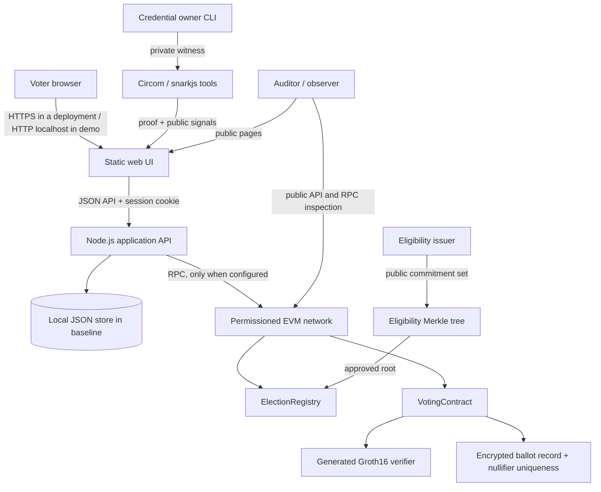

# CivicChain architecture

## Scope

CivicChain is a local academic prototype for exploring the division of responsibilities between a web application, a credential/eligibility process, zero-knowledge proof verification, encrypted ballot handling and a permissioned EVM ledger. The running baseline is deliberately smaller than the target architecture: the browser application and Node API are operational, while the real verifier/contract connection is optional and disabled until its matching artifacts and network are configured.

## Component map

The diagram describes the intended integration and optional components. It does **not** assert that a Besu consortium, verifier contract, threshold-decryption protocol or full tally pipeline is running by default.

## Trust boundaries

| Component | Trust assumption | What it should not learn or control |
|---|---|---|
| Browser/device | Can display and encrypt the selected choice correctly only if uncompromised | Must not send a private witness to telemetry or persistent browser storage |
| Authentication API | Validates account access and role authorization | Authentication must not be treated as election eligibility |
| Credential issuer | Checks who is eligible under the election's policy | Must not learn the plaintext selection |
| Proof verifier | Verifies the exact circuit version, public inputs and proof | Must not accept a `verified: true` request field as evidence |
| Voting contract | Enforces election open state, public-input binding and nullifier uniqueness | Must not trust a backend-only duplicate check |
| Consortium validators | Agree on transaction ordering under the configured consensus assumptions | Consensus alone does not establish fair voter registration or correct tallying |
| Tally trustees | Would jointly authorize decryption in the future protocol | Routine app administrators should not hold all private tally keys |
| Auditor | Independently checks published evidence | Should not need private witness material or identity documents |

## Data placement

- **Off chain:** account names/emails, password hashes, eligibility review metadata, session state, private credential files, private proof witness files, decryption shares and operational secrets.
- **On chain in the optional contract path:** election identifiers/schedule/commitments, approved root, accepted encrypted ballot payload, election-specific nullifier, events and references to tally evidence.
- **Public metadata:** configuration commitments, approved root versions, transaction references and published election data. Public hashes can still leak information when computed over guessable personal values; never publish hashes of raw identity records as a privacy shortcut.

## Baseline runtime architecture

`server.js` uses Node's built-in HTTP server and cryptographic libraries so the basic app can run without installing npm packages. `public/app.js` is a small client-side router. The baseline JSON store is a local demo store, not a multi-writer database. Data files are created in `data/` unless `CIVICCHAIN_DATA_DIR` overrides the path. Sessions are kept in process memory and therefore expire when the server restarts.

## Intended deployment architecture

For a stronger deployment, replace the JSON store with PostgreSQL, run multiple application instances behind a TLS reverse proxy, use a shared secure session store, separate the issuer and trustee services, deploy an actual permissioned QBFT network with protected validator identities, and configure a monitored RPC path. Generate and independently review the ZK verifier and circuit artifacts before any test vote can be accepted.
