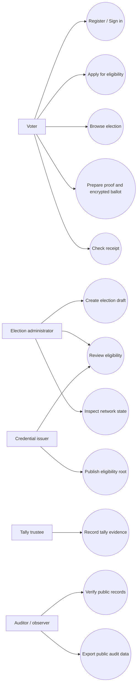
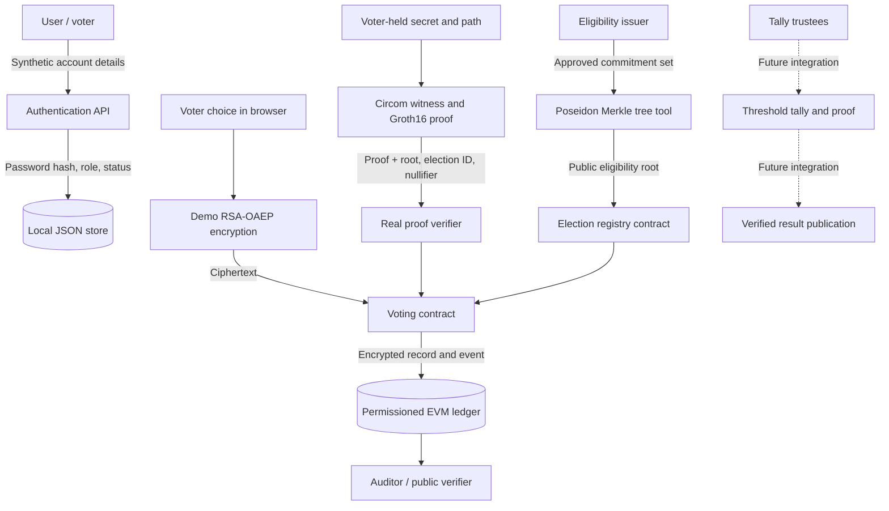
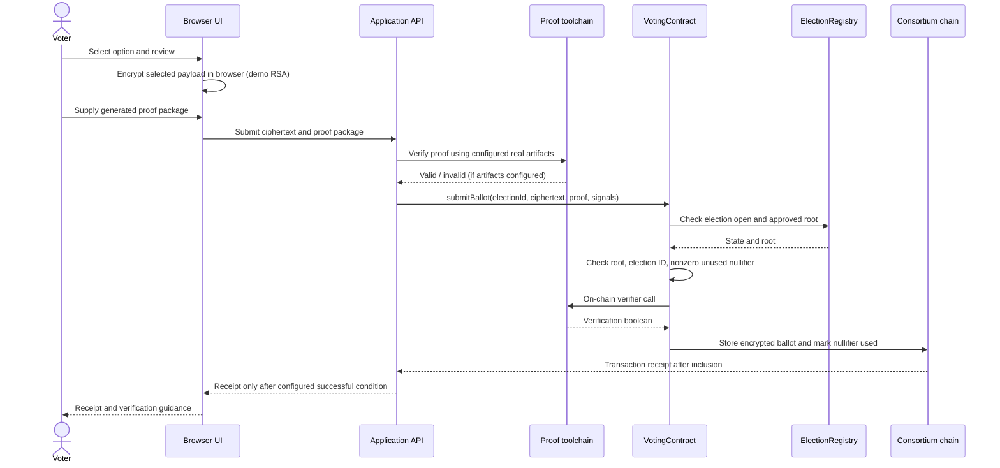
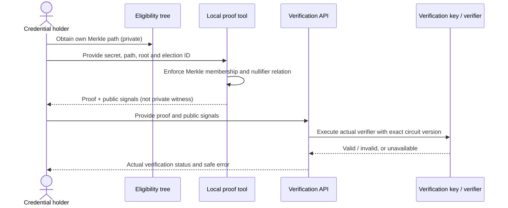
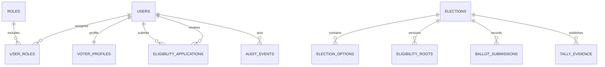

# Secure E-Voting System Using Consortium Blockchain and Zero-Knowledge Proofs

## 1. Abstract

CivicChain is an academic prototype for examining how a permissioned consortium blockchain and zero-knowledge proofs can support parts of a privacy-conscious electronic voting workflow. The system separates identity and eligibility information from public ledger evidence, expresses eligibility as a Merkle-membership relation, and uses an election-specific nullifier to prevent the same credential from submitting multiple accepted ballots in one election. Solidity source demonstrates governed election states and proof-gated encrypted ballot recording. A responsive web application exposes election discovery, account workflows, eligibility review, administration, network status and public verification concepts. The system is intentionally honest about its incomplete integration boundaries: it does not ship a bootable consortium network, built proof artifacts, homomorphic ballot scheme or verified threshold tally, and therefore blocks default ballot acceptance rather than simulating cryptographic success.

## 2. Introduction

Paper and conventional electronic voting systems make different trade-offs among access, privacy, auditability and operational complexity. A permissioned ledger may provide a shared tamper-evident record among known organizations, while a zero-knowledge proof may allow a participant to demonstrate a statement without revealing the private witness. Neither technology, by itself, guarantees a fair election or protects every stage of the voting process. CivicChain explores the architectural separation required to combine these mechanisms without placing personal information on chain.

## 3. Problem statement

A research voting application needs to prevent obvious duplicate submissions and expose evidence that can be inspected by independent observers, while avoiding direct publication of identity-to-choice mappings. A naive database-only design centralizes record control, and an ordinary blockchain transaction can reveal timing and account metadata. A secure design must specify eligibility, confidentiality, accepted-ballot semantics, governance and tally verification rather than equating a blockchain transaction with a valid vote.

## 4. Objectives

- Separate login identity from election eligibility.
- Demonstrate a Merkle-membership zero-knowledge proof with public election context and a derived nullifier.
- Enforce election lifecycle and nullifier uniqueness in a smart contract.
- Keep public records free of voter names, emails and plaintext selections.
- Provide a clear responsive interface for voters, administrators and auditors.
- Make proof/network status accurate and document missing security components.
- Include reproducible tests, setup instructions, source and a threat-model report.

## 5. Scope and non-goals

The prototype focuses on architecture and local demonstrability. It is not an election authority, identity proofing service or production deployment. Coercion resistance, legal compliance, fully anonymous voting, audited threshold encryption, an independent tally proof, complete event-level receipt verification and a bootable multi-validator network are not provided.

## 6. System overview

The frontend is a static HTML/CSS/JavaScript application with route handling and an editorial, cinematic navy design. A Node.js built-in HTTP server provides REST-like JSON endpoints. The baseline persistence layer is a local JSON file and the baseline session store is memory-resident. Optional scripts use Circom, circomlibjs and snarkjs for eligibility commitments and Groth16 proofs. Solidity contracts cover election registration, root publication, ballot acceptance and tally evidence references.

## 7. Roles

- **Voter:** creates a local account, applies for eligibility, reviews an election and may prepare a proof package using the research tooling.
- **Election administrator:** creates draft elections and is intended to manage governed lifecycle actions.
- **Credential issuer:** reviews eligibility and publishes approved roots in the chain-based design.
- **Consortium validator:** participates in transaction consensus in a separately provisioned permissioned network.
- **Tally trustee:** would participate in a separate threshold tally workflow; private shares are not part of the ordinary web app.
- **Auditor / observer:** inspect public election and transaction evidence without receiving private witness material.

The baseline app implements only a subset of these roles and workflows; unimplemented permissions do not imply working back-end functionality.

## 8. Eligibility and ZK proof model

A synthetic voter secret is transformed into a public Poseidon commitment. Approved commitments are placed in a fixed-depth Merkle tree. A holder constructs a witness with their secret and path. The circuit checks that the path opens to the public root and computes a domain-separated nullifier from the secret and election identifier. Public inputs bind the proof to the accepted root and election. A valid zero-knowledge proof can establish knowledge of a registered commitment opening without revealing the secret, under the correctness of the circuit and setup.

## 9. Ballot confidentiality and duplicate prevention

The intended submission contains encrypted ballot data and the public proof signals. The contract checks that the election is open, the proof public inputs match the configured root and election ID, and the nullifier is unused. The nullifier is marked used atomically with recording the encrypted ballot. The optional browser utility uses RSA-OAEP only as a demonstration payload encryption mechanism. It does not provide homomorphic tallying or threshold decryption, so it is not a complete privacy-preserving election encryption protocol.

## 10. Blockchain and governance

The Solidity registry defines election states, role checks, schedule enforcement and root locking after opening. The voting contract interfaces with a generated Groth16 verifier and records accepted encrypted ballot bytes. A separate tally registry records evidence references. The repository does not include a ready-to-run four-validator Besu QBFT genesis or validator keys; the deployment operator must provision the network and check its real consensus assumptions. Local chain source code alone does not mean distributed consensus is running.

## 11. Application features

The public UI has a homepage, election directory and detail view, login/register, voter dashboard, admin dashboard, election draft form, eligibility review queue, network dashboard, auditor view, results listing, receipt view, verification form and documentation section. The API provides registration/login/logout, session lookup, public election listing, application review, draft creation, status and verification routes. Routes for proof/tally operations that are not genuinely integrated are either unavailable or explicitly documented as boundaries.

## 12. Database design

The runtime prototype stores accounts, election records, applications, ballots, transaction metadata and audit events in `data/db.json`. A proposed normalized PostgreSQL schema is provided in `database/schema.sql` for future implementation. The current JSON format is single-process, not transactional across multiple instances, and is not suitable for production. Identity-to-ballot relations should be avoided, and private witness, selection, key or trustee-share data should not be stored in normal application tables.

## 13. Security controls

The baseline uses Node `scrypt` password hashes, HTTP-only and SameSite=Strict session cookies, login throttling, server-side role checks, request-size limits, structured safe error objects, a restrictive Content Security Policy and static file path protection. These are baseline controls rather than a complete hardened production security program. MFA, robust account recovery, a shared session store, database concurrency, full deployment TLS/reverse proxy configuration and independent auditing remain necessary for a serious deployment.

## 14. Testing

Ten dependency-free API integration tests cover server availability, explicit fixture labels, role protection, registration and duplicate accounts, session behavior, draft creation, safe ballot refusal without proof artifacts, and unverifiable transaction behavior without RPC. Contract tests are included but use a test-only permissive verifier and therefore do not establish cryptographic proof validity. Circom compilation, Groth16 generation, generated verifier execution, Solidity static analysis and a multi-validator network test were not run in the authoring environment.

## 15. Results and implementation assessment

The project demonstrates the front-end/backend scaffolding, a source-level eligibility proof relation, a contract-enforced nullifier design and clear status semantics. The default run is intentionally safe: missing proof/network configuration leads to a refusal rather than a mock success. It does not yet demonstrate end-to-end voting with a genuine proof and a deployed consortium network, because the optional toolchain and network setup must be provisioned first.

## 16. Limitations

The most important limitations are the JSON persistence layer, partial identity and eligibility workflows, locally generated trusted-setup artifacts, no bundled validator network, lack of a ballot-validity proof, RSA rather than homomorphic encryption, no threshold tally implementation, and incomplete transaction event verification. Further, a compromised voter device may observe the selected option; public nullifiers and transaction timing may permit correlation; governance/issuer behavior still requires trust; and the system is not coercion-resistant by construction.

## 17. Future work

1. Replace JSON with PostgreSQL, migrations, transactional constraints and multi-instance-safe processing.
2. Implement secure recovery, MFA, issuer governance and credential lifecycle/revocation.
3. Generate and independently inspect the circuit artifacts and run proof-to-contract integration tests.
4. Package a reproducible, local-only Besu QBFT multi-validator network with distinct node keys and fault-injection tests.
5. Replace RSA-OAEP with a reviewed homomorphic scheme and proof of ballot validity.
6. Implement distributed threshold tallying, share verification and an independent reproducible tally proof.
7. Complete a public receipt verifier that decodes contract events and verifies inclusion/finality policy.
8. Add dependency/static analysis, threat-driven end-to-end tests, WCAG testing and independent security reviews.

## 18. Conclusion

CivicChain provides a transparent academic foundation for exploring secure e-voting concepts and makes the distinction between a design idea and an operational security property explicit. A consortium blockchain can make accepted records tamper-evident under its governance and consensus assumptions, and a zero-knowledge proof can hide a witness while proving a constrained statement. Election confidentiality and correctness still depend on well-defined encryption, ballot validity, key governance, device security, eligibility issuance, independent tally verification and operations. The delivered build is suitable for controlled learning and further development, not for conducting a binding election.

## References

- Circom documentation, “The main component”: https://docs.circom.io/circom-language/the-main-component/
- OpenZeppelin Contracts documentation, “Access Control”: https://docs.openzeppelin.com/contracts/5.x/access-control
- OpenZeppelin Contracts API, access control: https://docs.openzeppelin.com/contracts/5.x/api/access
- `snarkjs` and Circom tool output should be pinned to the exact version used in any reproducible experiment. Consult the corresponding project documentation and cryptographic research literature when implementing the tally protocol.

## Appendix A. System diagrams

### A1. Use-case diagram



The diagram represents target roles and use cases. Several cryptographic and governance actions are only partially implemented in the delivered baseline.

### A2. Data-flow diagram



### A3. Voting sequence diagram



The real transaction path is blocked in the default local run because no proof artifacts or deployed chain are configured. This sequence shows the target integration, not a claimed executed vote.

### A4. Proof-verification sequence diagram



### A5. Proposed relational data model



The schema deliberately leaves `ballot_submissions` without a direct `user_id` link. The SQL is a proposal; the runtime adapter and migrations are not yet integrated.

## Appendix B. Requirements and feasibility

### B1. Functional requirements

- Create and authenticate synthetic user accounts.
- Enforce backend role checks for protected API operations.
- Let users browse election records and inspect schedules/options.
- Accept eligibility applications and let authorized issuers record review outcomes.
- Let authorized administrators create election drafts and review configuration.
- Expose network and cryptography readiness without inventing unconfigured values.
- Generate and verify an eligibility proof package using the optional local toolchain.
- Gate any ballot record on genuine proof verification and a real configured contract.
- Provide public transaction lookup and mark ballot claims unverifiable if event/protocol checks are absent.
- Document the proposed tally and publication workflow without presenting unimplemented tally results as verified.

### B2. Non-functional requirements

- Privacy: avoid sending voter identity fields to the public ledger and avoid retaining plaintext choices in ballot records.
- Integrity: enforce election states and duplicate-nullifier invariants in the contract path.
- Maintainability: separate app UI, backend handlers, contracts, circuits and scripts.
- Accessibility: use form labels, focusable controls, semantic headings and responsive CSS.
- Reproducibility: provide local commands, fixture accounts, tests and generated artifact instructions.
- Honesty: report missing proof and network dependencies as unavailable, and label fixture values.

### B3. Feasibility assessment

**Technical feasibility:** the baseline web application and API operate with Node's built-in libraries. Circom/snarkjs and Solidity sources offer a plausible research integration path, but the toolchain must be installed and tested as a coherent version set. A secure homomorphic tally and a permissioned multi-validator environment require additional implementation and review.

**Operational feasibility:** the local demo is suitable for a controlled lab machine and synthetic data. The current file store, process-local sessions, mock mail outbox and absent validator bundle are not suitable for a multi-user service.

**Economic feasibility:** no paid third-party API is required for the basic baseline. A stronger deployment will still have infrastructure, audit, identity governance, key ceremonies and operational costs.

**Legal and ethical feasibility:** not established. Any real election requires independent legal analysis, stakeholder governance, accessibility review, and consideration of voter coercion, endpoint compromise and dispute procedures.

### B4. Hardware and software requirements

Baseline: a development computer with Node.js 20+, modern browser, enough storage for a local JSON store and repository checkout. Optional cryptographic setup requires compatible Node packages, Circom/circom2, circomlib, circomlibjs and snarkjs and additional CPU, RAM and disk for circuit setup artifacts. Optional contract tests require Hardhat, OpenZeppelin Contracts and ethers. A Besu consortium deployment requires separately provisioned validator nodes/containers, persistent volumes, peer connectivity, generated node keys and a valid QBFT genesis configuration. No exact performance targets are claimed because no benchmark was run in this authoring environment.

## Appendix C. Existing system analysis and algorithm sketch

### C1. Existing approaches

- **Paper ballots:** support physical custody and can be audited through procedures, but require physical logistics, manual counting or scanning, and accessible in-person participation arrangements.
- **Centralized electronic voting:** can be fast and convenient, but system operators and database controls become central trust points. A database log alone does not provide independently replicated consensus.
- **Public blockchain voting:** gives public transaction transparency, but a transparent address/transaction graph can expose timing and participation metadata; public-chain usage also does not establish that a voter is eligible or that tallying is correct.
- **Permissioned consortium ledger:** allows a defined group of validators to agree on a shared record, but shifts trust to governance, node independence, key protection, and consensus configuration.
- **Zero-knowledge eligibility proofs:** can prove membership/knowledge of a credential without disclosing the witness, but do not encrypt the ballot, prove a valid ballot encoding, or provide a correct tally by themselves.

CivicChain combines the last two ideas as a research architecture while documenting the extra independent mechanisms required to make a full voting protocol.

### C2. Eligibility and nullifier pseudocode

```text
ISSUER:
  for each approved synthetic credential:
    commitment <- Poseidon(voter_secret)  // secret remains with credential holder
  root <- build_depth_4_merkle_tree(commitments)
  publish root and version before election opening

VOTER:
  witness <- {voter_secret, merkle_path, path_directions}
  public_inputs <- {approved_root, numeric_election_id}
  proof, public_signals <- Groth16Prove(witness, public_inputs)
  // public_signals contains root, election_id and circuit output nullifier

CONTRACT SUBMISSION:
  require election_is_open(election_id)
  require public_root == registry.root(election_id)
  require public_election_id == election_id
  require nullifier != 0 and unused(election_id, nullifier)
  require Groth16Verifier(proof, public_signals)
  mark nullifier used and store encrypted ballot atomically
  emit acceptance evidence
```

This pseudocode describes the target proof-gated contract path. The default run does not execute a completed proof-to-chain ballot because the verifier artifacts and network are not configured.

### C3. Result verification pseudocode (future integration)

```text
require election closed and ballot record set finalized
ciphertexts <- retrieve accepted ciphertexts from the approved contract
aggregate <- specified homomorphic aggregation(ciphertexts)
shares <- collect authorized threshold decryption shares
verify each share and combine only if threshold requirements are met
result <- decode and validate aggregate tally
verify public tally artifact using independent verifier
publish result commitment and references only after successful verification
```

The aggregation, threshold decryption and tally-proof steps are not implemented in the current code. No performance estimate or result-verification claim is made for them.

## Appendix D. Performance measurement plan

No throughput, latency, proof-generation or block-finality benchmark was run for this delivery. To produce a meaningful report, record the exact CPU/RAM/OS, browser/device, Node/toolchain versions, validator count and network settings; measure proof generation locally, proof verification in Node and Solidity separately, ballot submission/inclusion/finality separately, and API p50/p95/p99 latency under a disclosed concurrency profile. Do not extrapolate development-laptop measurements to voters' mobile devices.
